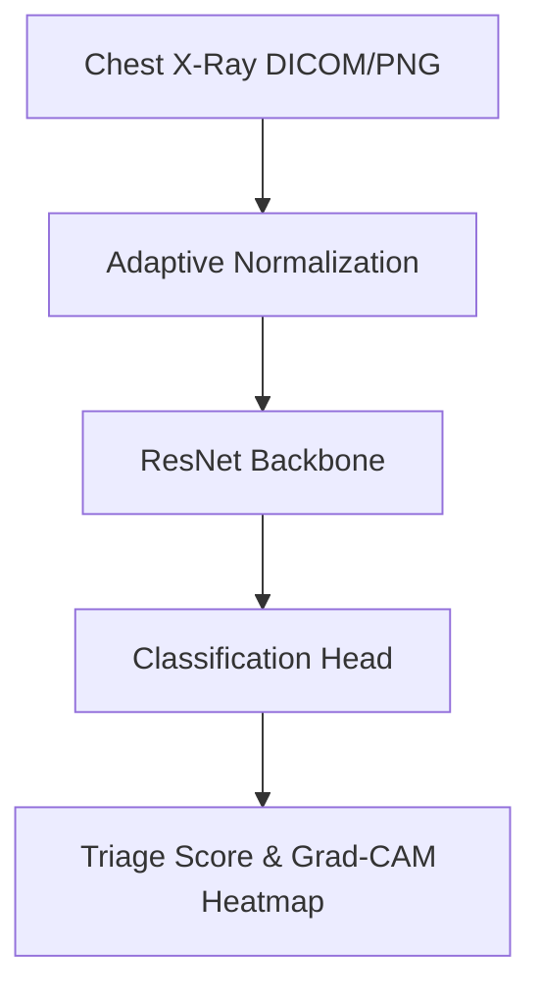

# Medical Image Classifier: Chest Radiograph Pathology Detection


A deep learning medical computer vision system designed to support clinical triage by classifying chest radiographs into 4 conditions:
1. Normal
2. Bacterial Pneumonia
3. Viral Pneumonia
4. Atelectasis

## Key Features
- **Transfer Learning**: Custom ResNet-18 architecture fine-tuned on pulmonary imaging
- **Explainable AI**: Grad-CAM visual heatmaps highlighting anatomical areas of interest
- **High Throughput**: Multi-threaded batch inference engine and CLI diagnostic utility

## Architecture & Workflow


## Quick CLI Execution
```bash
python src/cli.py --batch-size 3
```
